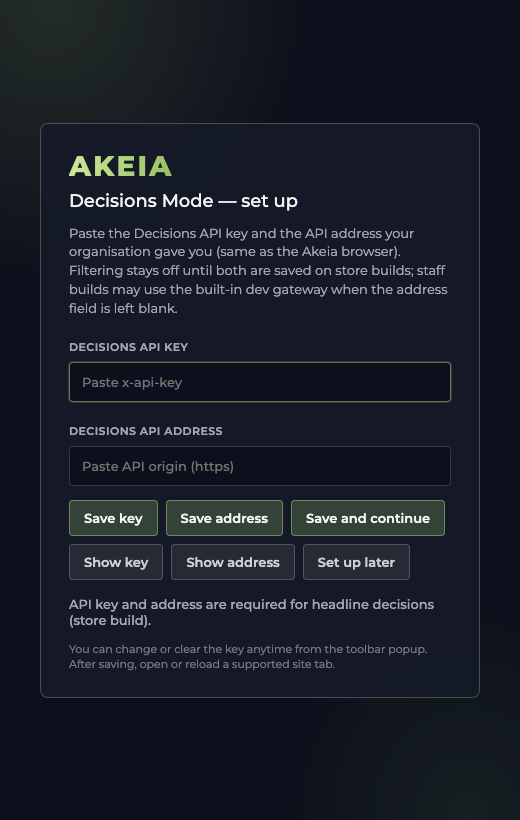

# Akeia Decisions Chrome extension

The **Akeia Decisions** Chrome extension brings **Decisions Mode** to Google Chrome on supported news and media sites. It uses the same Decisions API as the Akeia browser so your organisation can offer **sentiment-aware headline filtering without routing traffic through a desktop proxy**.

Decisions Mode classifies headlines through your organisation’s API and **soft-filters** content (blur and optional reveal) rather than blocking pages.

## What it helps you achieve

- **Protect focus and wellbeing** on work machines by reducing exposure to strongly negative headlines while you browse supported publishers.
- **Keep pages usable** — layout and navigation stay intact; individual cards or headline elements can be blurred when the API marks them as negative.
- **Use a familiar browser** — Chrome with a small extension, while IT keeps control of the API key and API endpoint your tenant uses.

Filtering does not run until you have agreed to privacy & consent, saved a valid **API key** and **API address**, and turned filtering on.

## Before you start

Your organisation (or Akeia) should provide:

| Item | What it is |
| --- | --- |
| **Decisions API key** | Secret used as the `x-api-key` header on requests to the Decisions API. Treat it like a password. |
| **Decisions API address** | The HTTPS **origin** of the API (scheme + host + port only), for example `https://decisions.example.customer.akeia.ai`. Do not include a path such as `/decisions` — the extension appends that. |

You also need a supported version of Google Chrome and permission to install the extension (Chrome Web Store, enterprise force-install, or your organisation’s approved channel).

Supported **publisher sites** are defined in the extension release (major UK and international news sites). Open a supported site in a normal tab after setup; the extension does not filter arbitrary domains.

## First-time setup

1. Install the extension using your organisation’s approved method.
2. On first run, complete **Privacy & consent** when prompted (or open it from the toolbar popup).
3. Open the **Decisions Mode — set up** page (shown on install, or via the toolbar popup → **Open API setup**).
4. Enter your **Decisions API key** and **Decisions API address**, then choose **Save and continue** (or save each field separately).
5. If Chrome asks to allow access to the API host, approve it — the extension cannot call your tenant API without that permission.
6. Open the toolbar popup, ensure **Enable Decisions filtering** is on, and reload any supported publisher tabs.

## Setup fields and actions

The first-run page and the toolbar popup use the same two credentials.

### Decisions API key

- Paste the key your organisation issued (shown as a password field).
- **Save key** stores it in Chrome local storage on this profile only.
- **Show key** / **Hide** toggles visibility while you paste or check the value.
- **Clear key** (popup only) removes the stored key.

### Decisions API address

- Paste the full HTTPS origin, for example `https://decisions.customer.example`.
- Must be **HTTPS** on production builds (staff-only developer builds may allow a local loopback address).
- User names, passwords, or wildcards in the host are rejected.
- **Save address** validates the URL, requests host permission from Chrome if needed, then stores the origin.
- After a successful save, the field may show **Address saved** instead of the live URL (you can use **Show address** to view what is stored).

### Other controls on the setup page

| Control | Purpose |
| --- | --- |
| **Save and continue** | Saves both key and address in one step (recommended). |
| **Set up later** | Marks setup as seen so you can finish from the popup later. Filtering stays off until both values are saved on store builds. |

You can change or clear the key and address anytime from the toolbar popup. **Reload publisher tabs** after changing enable state, key, or address.

## Toolbar popup

Click the Akeia icon in the Chrome toolbar to open the popup:

- **Enable Decisions filtering** — master switch for the extension.
- Same **API key** and **API address** fields as setup.
- Status line reflecting connection and API health (for example ready, network issue, or key rejected).
- **Open privacy & consent** and a link to the [extension privacy notice](https://akeia.ai/pages/decisions-extension-privacy.html).
- **Open API setup** — full-page setup view.

Version and content-pack labels may appear at the bottom for support diagnostics.

## How filtering works (overview)

At a high level:

1. On a **supported site**, the extension finds headline cards using site-specific rules bundled with the release.
2. Headline text is sent to your organisation’s **Decisions API** (`POST /decisions`) with your API key.
3. The API returns a decision per headline (for example whether content is treated as negative for filtering).
4. The extension **applies** the result on the page — typically blurring matching cards and showing a short status label. You can often **reveal** a blurred card if you choose to read it.
5. Recent results are cached locally (hashed keys, time-limited) to reduce repeat calls.

If the API cannot be reached or returns an error, the extension **does not guess** sentiment: affected headlines may stay blurred or show an **Unable to classify** state until the API responds. Check the popup status and your network path to the API host.

The extension does **not** read your passwords, payment details, or unrelated browsing history. It runs only on hosts declared in the extension manifest. Details are in the [privacy notice](https://akeia.ai/pages/decisions-extension-privacy.html).

## Privacy and support

- **Privacy notice (public):** [akeia.ai/pages/decisions-extension-privacy.html](https://akeia.ai/pages/decisions-extension-privacy.html)
- **This site:** further product and deployment guides will be added here as they are published.
- **Need help?** Contact your organisation’s IT team or Akeia support with the popup status text and whether the API host is reachable from your network.

## Related products

**Akeia Browser** is the desktop app with the same Decisions Mode and additional features for organisations that prefer a dedicated browser instead of Chrome plus the extension.